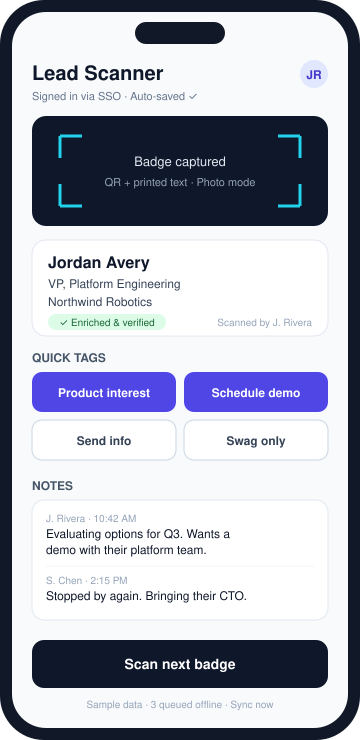
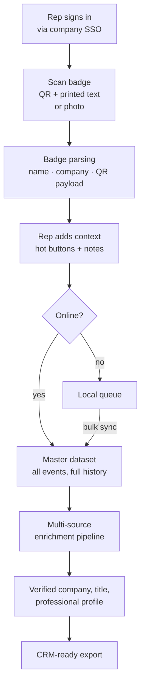

# Event Lead Scanner

**A mobile-first lead capture app for in-person events, built for AI-centric GTM teams.**

Scan a badge, tap what the conversation was about, and walk away. The app reads the badge, identifies the person and company, enriches the record, and drops it into a central system of record that's ready for CRM import. It also records who on your team had the conversation.

  

> **Showcase repository.** This repo documents the product, architecture and build process. Source code, prompts, parsing logic and integration configuration are private. All data shown is fictional.

---

## The problem

At a busy conference booth, lead capture usually breaks down in the same few ways:

- Rented badge scanners return incomplete data, often days after the event.
- Reps jot notes on paper or their phones, and context is lost before follow-up.
- Nobody knows which rep talked to which lead, so follow-up gets duplicated or dropped.
- Spotty venue Wi-Fi means captures fail silently.
- Post-event cleanup (deduping, fixing titles, finding the right company) takes days before anything reaches the CRM.

## What it does

| Capability | Description |
|---|---|
| **Badge capture** | Reads the QR code on a badge *and* parses the printed name and company. Works from a live camera scan or a photo of the badge. |
| **Rep attribution** | Every user signs in through company SSO, so each scan, note and edit is tied to a verified team member. |
| **One-tap qualification** | Hot buttons for **Product(s) of interest**, **Schedule demo**, **Send info** and **Swag only**, plus an open notes field. |
| **Full edit history** | Several reps can add notes to the same lead. Every entry is kept with who wrote it and when. Nothing is overwritten. |
| **Auto-save** | Each change is saved as it happens. No submit button to forget. |
| **Offline resilience** | Captures queue locally when connectivity drops, and you can bulk-upload them when you're back online. |
| **Automated enrichment** | Records run through a multi-source enrichment pipeline to confirm company, title and professional profile. |
| **Central system of record** | All captures from every event land in one master dataset with full history, structured for CRM import. |
| **Installable** | Progressive Web App. Add it to your home screen on iOS or Android and use it like a native app, with no app store needed. |

## How it works

More detail is in [docs/ARCHITECTURE.md](docs/ARCHITECTURE.md).

## Results

The first version worked as a prototype but not as a product: badge parsing was unreliable and the output wasn't usable. After a round of iteration on the capture and parsing pipeline:

- **95%+** of captured badges were parsed and enriched successfully.
- Every record carried rep attribution, qualification hot buttons and free-text notes.
- The dataset was **CRM-import ready right after the event**, with no multi-day cleanup.

The iteration story is in [docs/BUILD-LOG.md](docs/BUILD-LOG.md).

## Tech overview

| Layer | Approach |
|---|---|
| Client | Installable Progressive Web App (mobile-first) |
| Auth | Company SSO (enterprise identity provider) |
| Capture | Device camera: QR decoding plus printed-text extraction from badge images |
| Storage | Central cloud master dataset with an append-only note history |
| Enrichment | Multi-source B2B data enrichment pipeline |
| Output | Structured, deduplicated records formatted for CRM import |
| Built with | AI-assisted development using Claude Opus 5.5 |

## Roadmap

- [ ] Direct CRM push (skip the import step)
- [ ] Lead scoring and routing based on hot buttons and enrichment data
- [ ] Event dashboard: live scan counts and rep leaderboard
- [ ] AI-drafted follow-up emails generated from rep notes
- [ ] Multi-event and multi-team workspaces

## About

Built by [@mlb707dev](https://github.com/mlb707dev), a GTM leader who builds AI tools for sales teams.

## License

Copyright © 2026 mlb707dev. All rights reserved.
This repository is for portfolio and demonstration purposes. No license is granted to use, copy, modify or distribute any part of it. See [NOTICE](NOTICE).
