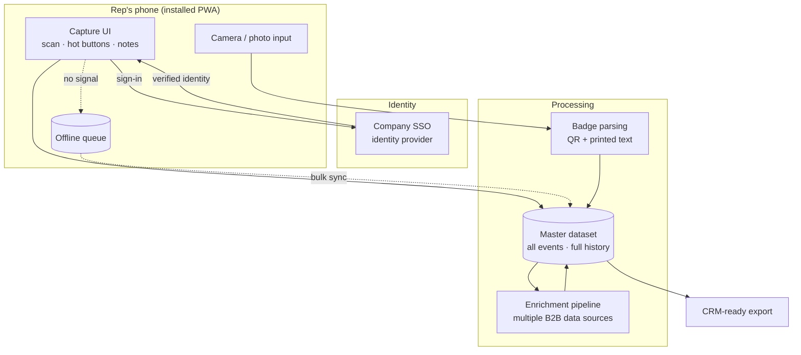

# Architecture

A high-level view of how Event Lead Scanner is put together. Implementation details are intentionally left out.

## System overview



## Components

### 1. Client: installable web app
- Mobile-first Progressive Web App. Reps install it from the browser to their home screen.
- One codebase for iOS and Android, with no app store review cycle.
- Each field auto-saves as it changes.

### 2. Identity and attribution
- Every user signs in through the company's SSO before they can capture anything.
- The verified identity is stamped on each action:
  - **Scanned by:** who captured the badge
  - **Note author:** who wrote each note
  - **Last edited by:** who most recently changed the record
- This removes the "who talked to this person?" question after the event.

### 3. Capture
- **Live scan:** decodes the badge QR code through the device camera.
- **Printed-text parsing:** reads the name and company printed on the badge. This is useful when QR payloads are incomplete or encoded in a vendor-specific way.
- **Photo mode:** a rep can photograph a badge and process it later. This helps in crowded or low-light booths.

### 4. Qualification
- One-tap hot buttons capture intent quickly:
  - Product(s) of interest (multi-select)
  - Schedule demo
  - Send info
  - Swag only
- An open free-text notes field covers everything else.

### 5. Data model (conceptual)
```
Lead
 ├── identity        (name, company, contact fields from badge)
 ├── enrichment      (verified company, title, professional profile)
 ├── qualification   (hot-button selections)
 ├── captured_by     (SSO user, timestamp)
 └── notes[]         (append-only: author, timestamp, text)
```
Notes are **append-only**. Several reps can add context to the same lead without overwriting each other, and the full history is kept.

### 6. Offline resilience
- Venue connectivity is unreliable, so captures queue on the device when there's no signal.
- Queued records bulk-upload once the device is back online.

### 7. Enrichment
- Each record passes through a pipeline that cross-references several B2B data providers.
- Goal: confirm the person's **current company and title** and attach a **professional profile** link, so reps follow up with accurate context.

### 8. Output
- One master dataset across every event, with full history.
- Records are structured and deduplicated for direct CRM import.

## Design principles

1. **Speed at the booth wins.** Capture takes seconds. Everything else happens in the background.
2. **Never lose a lead.** Auto-save, offline queueing and photo fallback each cover a different failure mode.
3. **Attribution by default.** SSO makes ownership automatic instead of relying on manual entry.
4. **History over overwrite.** Context from every rep is kept.
5. **CRM-ready, not CRM-dependent.** Clean structured output, whatever the downstream system.
